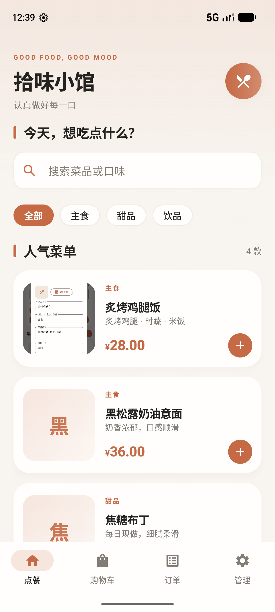
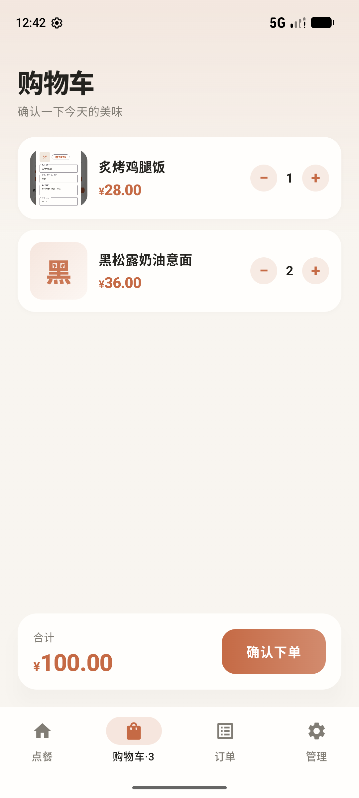
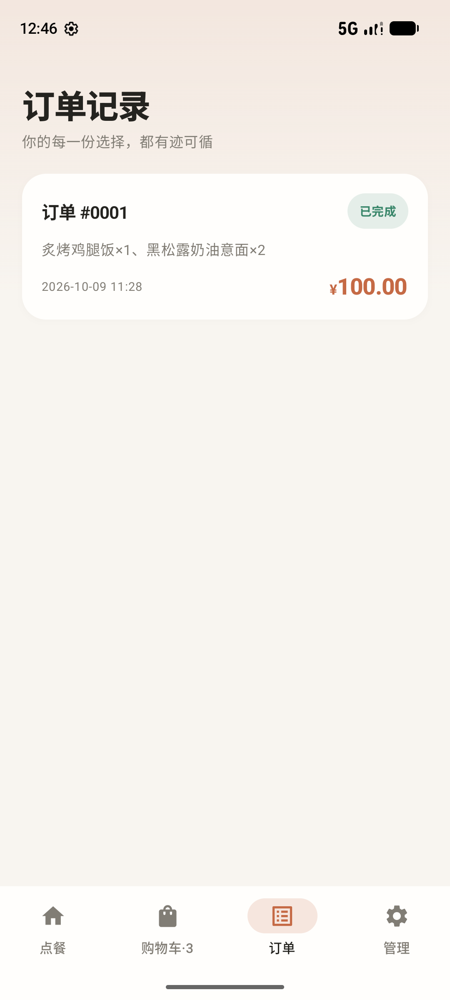
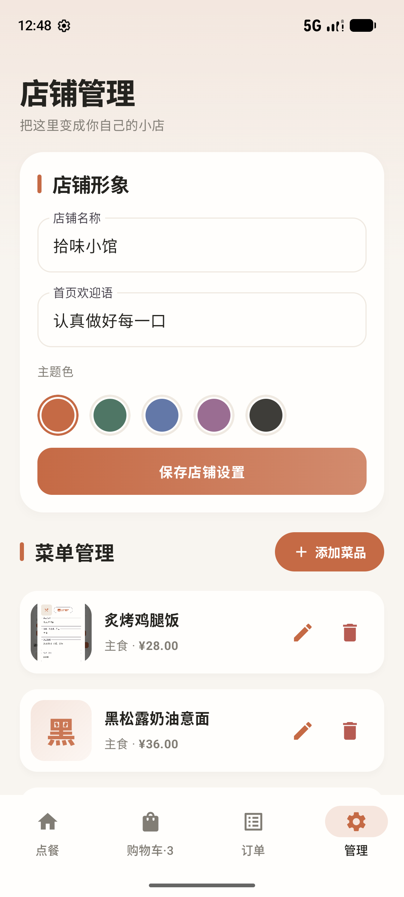

<div align="center">

# LocalBite · 拾味

**An offline-first, account-free ordering app for Android — built with Jetpack Compose.**

一款**不联网、不需要账号**的纯本地点餐 App：首页点单、购物车、订单状态流转、店铺管理，数据只保存在手机上。


   

</div>

---

## 项目简介

LocalBite 是一个**可日常使用**的点餐 MVP，而不是 Demo 壳：它不申请任何网络权限、没有账号体系、不依赖后端，安装即可在飞行模式下完成从选菜到下单的全流程。数据通过 Room 持久化在本机，支持带图片的整包备份与恢复。

**技术选型**：Kotlin + Jetpack Compose（Material 3）+ Room + Kotlin Coroutines/Flow，单 Activity 架构，全程无第三方 UI 库。

> 这个项目用来展示：现代 Android 声明式 UI 开发、本地数据库设计、响应式数据流，以及从构建到签名发布的完整工程能力。

## 功能特性

**🍟 点餐首页**
- 分类筛选（全部 / 主食 / 饮品 / 甜品，横向滚动）、关键词搜索（含空结果引导）
- 菜品卡片：主题色占位图（菜名首字排版）、数量加减与购物车实时联动
- 店铺头部：店名、欢迎语、主题色随设置即时生效

**🛒 购物车**
- 实时合计（分转元精确计算）、数量调整、一键下单
- 合计栏与主按钮采用悬浮卡片 + 主题色渐变

**📄 订单**
- 订单历史按时间倒序，状态四色胶囊区分
- 详情弹窗：菜品明细、状态机流转 `已下单 → 制作中 → 已完成`，可取消
- 删除订单带二次确认，防误触

**⚙️ 管理**
- 菜品增删改查：系统图片选择器选图，图片复制到 App 私有目录持久保存
- 店铺定制：店名、欢迎语、五套主题色
- **ZIP 数据备份 / 恢复**：`backup.json` + `images/` 打包菜品图片，恢复时自动重建图片路径；按 `PK` 魔数兼容旧版纯 JSON 备份
- 首次启动自动写入演示菜品

## 技术亮点

| 方面 | 做法 |
|---|---|
| **零网络依赖** | Manifest 不声明 `INTERNET` 权限，点餐全流程飞行模式可用，从根本上避免隐私与联网问题 |
| **响应式数据流** | DAO 返回 `Flow<List<T>>`，UI 通过 `collectAsStateWithLifecycle` 订阅，任何一处写库自动刷新四个页面 |
| **声明式 UI + 状态提升** | 购物车、分类、搜索等状态统一提升到根组件，四个页面组件无内部可变状态依赖，联动天然一致 |
| **图片持久化** | `content://` URI 选图后立即拷贝至私有目录，规避系统 URI 权限过期；加载失败时以「菜名首字 + 主题渐变」兜底 |
| **备份一致性** | 备份包内图片按相对路径记录，恢复时解压并改写 `imagePath`，保证换机 / 清数据后完整还原 |
| **数据库完整性** | Room `version = 1` + `identity_hash` 校验，实体字段设计与建表 SQL 严格对应，升级安装不丢数据 |
| **主题系统** | Material 3 `lightColorScheme` 由店铺主题色动态派生，chips / 导航 / 按钮全部走主题 token，换色全局生效 |
| **工程化** | Gradle Kotlin DSL、Compose BOM 统一版本、KSP 注解处理、正式签名 release（密钥配置不入库） |

## 技术栈

| 层 | 选型 |
|---|---|
| 语言 | Kotlin 2.0.21 |
| UI | Jetpack Compose、Material 3、Compose BOM `2024.12.01`、Material Icons Extended |
| 数据 | Room 2.6.1（KSP）、Kotlin Coroutines 1.9、`kotlinx-coroutines-flow` |
| 生命周期 | `lifecycle-runtime-compose` / `lifecycle-viewmodel-compose` |
| 构建 | Gradle 9.3.0 + Kotlin DSL、Android Gradle Plugin 8.7.3、JDK 17 |
| 平台 | minSdk 26 / target & compileSdk 35 |

## 项目结构

```text
LocalBite/
├── app/
│   ├── build.gradle.kts
│   └── src/main/
│       ├── AndroidManifest.xml            # 无 INTERNET 权限
│       ├── java/com/localbite/app/
│       │   ├── MainActivity.kt            # 全部 Compose UI 与备份逻辑
│       │   └── data/
│       │       ├── AppDatabase.kt         # Database + ProductDao/OrderDao/SettingsDao
│       │       └── Entities.kt            # Product / OrderEntity / ShopSettings
│       └── res/values/styles.xml
├── docs/screenshots/                      # README 截图
├── build.gradle.kts                       # 插件版本
├── settings.gradle.kts
└── gradle.properties
```

## 快速开始

**环境**：Android Studio（Ladybug 或更新）、JDK 17、Android SDK Platform 35。

```bash
# 克隆后直接构建（首次会下载 Gradle 9.3 与 Maven 依赖）
./gradlew assembleDebug

# 安装到已连接设备 / 模拟器
adb install -r app/build/outputs/apk/debug/app-debug.apk
```

也可以用 Android Studio 打开工程根目录，等待 Sync 完成后点 Run。

**生成签名 release APK**（仓库不含密钥，需自行配置）：

1. 准备自己的密钥：`keytool -genkeypair -v -keystore release.keystore -keyalg RSA -validity 10000`
2. 在工程根目录新建 `keystore.properties`（已在 `.gitignore` 中，不会被提交）：

```properties
storeFile=release.keystore
storePassword=你的密码
keyAlias=你的别名
keyPassword=你的密码
```

3. `./gradlew assembleRelease` → `app/build/outputs/apk/release/app-release.apk`
   - 未配置该文件时 release 会回退 debug 签名，保证他人 clone 后也能构建通过。

> 仓库根目录附带了已构建的签名版 `LocalBite-1.0.0.apk`，下载后允许「安装未知来源应用」即可体验。

## 数据与备份

- App 无联网权限，不调用任何远程 API；每台手机数据独立，不跨设备同步。
- **卸载会清除本地数据**，请先在「管理」页导出备份。
- 备份为 ZIP：`backup.json`（菜品 / 订单 / 店铺设置）+ `images/`（菜品图片）；恢复时自动解压并重建图片路径，旧版纯 JSON 备份同样兼容。
- 恢复会覆盖当前全部数据。

## 测试与验收

已在 Android 模拟器（1080×2400）完成以下实测，全程 logcat 无崩溃：

- [x] 四页面 UI 走查：首页 / 购物车 / 订单 / 管理
- [x] 加购联动、总价计算、下单跳转订单页
- [x] 分类筛选、搜索结果与空状态引导
- [x] 强制停止 App 后重开，数据持久化正常
- [x] 导出 ZIP 备份（含图片）→ `pm clear` 清空 → 恢复，菜品 / 图片 / 订单状态全量还原
- [x] 订单状态推进（已下单 → 制作中 → 已完成）、取消与删除二次确认
- [x] 签名 release 包构建，`apksigner verify` 证书校验通过

**手工验收步骤**（克隆后可按顺序自测）：

1. 首次打开首页能看到演示菜品；搜索、切换分类正常。
2. 添加两种菜品进购物车，改数量，核对总价。
3. 提交订单后订单页出现记录；强制停止重开，记录仍在。
4. 管理页新增菜品并选择本地图片，首页可见菜品与图片。
5. 修改店名 / 欢迎语 / 主题色，返回点餐页检查变化。
6. 导出 ZIP 备份，清空 App 数据后恢复，菜品、图片、订单状态全量回来。
7. 打开一笔订单推进状态、取消，再删除并确认二次弹窗。
8. 开启飞行模式重复点餐，核心功能不受影响。
9. 安装签名 release APK，确认与 debug 包行为一致。

## 版本历史

- **v1.0.0**（2026-10）— 首个完整版本：四页面 MVP、订单状态机与删单确认、ZIP 图片备份、整套 UI 打磨（主题渐变 / 卡片投影 / 状态胶囊）、正式签名发布。

## Roadmap

- 自动化 UI 测试（Compose Test / Espresso）
- 销量统计与库存管理
- 多设备同步 / 手动支付对接
- 深色模式与多语言

---

*本项目为个人学习与作品展示用途，欢迎 Star 与交流。*
